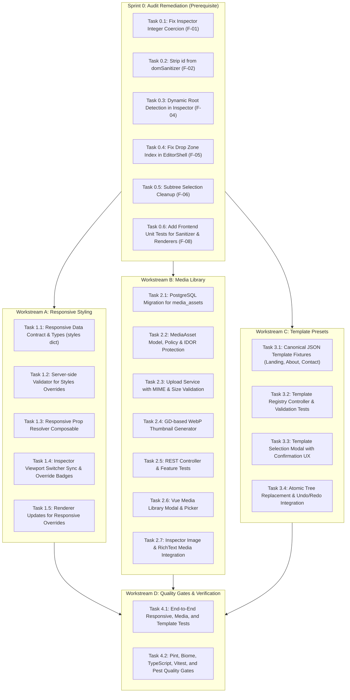

# Phase 06 — Business Analysis & Technical Implementation Plan
**Responsive Styling, Media Library, and Template Presets**  
**Document Version:** 1.0.0 | **Date:** 2026-10-17  
**Roles:** Principal Software Architect, Senior Laravel/Vue Engineer, Security Reviewer, Technical Business Analyst  
**Repository:** `D:\pentagon` | **Target Phase:** Phase 06 | **Prerequisite Phase:** Phase 05 (Audited)

---

## 1. Executive Summary & Phase Objectives

Phase 06 equips the Page Builder Admin with three pivotal capabilities while preserving low-resource server constraints (2GB RAM budget, no heavy services, no Redis/Octane/SSR):

1. **Responsive Styling (Workstream A):** Enables viewport-specific style overrides (Desktop, Tablet, Mobile) without bloating or breaking Document Schema v1, allowing seamless preview and publishing parity.
2. **Media Library (Workstream B):** Delivers a secure, multi-tenant asset repository with strict MIME content validation, safe non-executable storage, website-scoped isolation (IDOR protection), and lightweight thumbnail generation.
3. **Template Presets (Workstream C):** Provides canonical, schema-validated starter templates (Landing Page, About Page, Contact Page) with atomic replacement, undo/redo integration, and modal confirmation.
4. **Audit Remediation (Workstream 0):** Immediately resolves the 5 functional and security defects identified during the Phase 05 technical audit (integer prop coercion, DOM clobbering, hardcoded root checks, drop index handling, and selection cleanup).

---

## 2. Workstream 0: Phase 05 Defect Remediation (Prerequisite)

Before introducing new Phase 06 capabilities, the following defects discovered during the Phase 05 audit must be resolved to guarantee data integrity between client mutations and backend validation:

1. **F-01 (High): Type Coercion for Integer Enums in Inspector:**
   - *Target:* `resources/js/components/editor/InspectorPanel.vue`
   - *Fix:* When `<select>` emits a change for a property whose `schema.type === 'integer'`, parse the value with `parseInt(val, 10)` before dispatching `updateProp`. Ensures `Heading.level`, `Columns.count`, and `CardGrid.columns` remain integers.
2. **F-02 (High): Disallow `id` in Client DOM Sanitizer:**
   - *Target:* `resources/js/lib/domSanitizer.ts`
   - *Fix:* Remove `id` from the permitted attribute allowlist to eliminate DOM clobbering vectors against `document` and `window` in the active editor canvas.
3. **F-04 (Medium): Dynamic Root Node Identification:**
   - *Target:* `resources/js/components/editor/InspectorPanel.vue`
   - *Fix:* Replace `selectedNode.id !== 'root'` with `!isRoot` or `selectedNode.id !== document.root.id` to prevent Delete/Duplicate buttons from rendering on `root_section_default`.
4. **F-05 (Medium): Drop Zone Insertion Index Support:**
   - *Target:* `resources/js/components/editor/EditorShell.vue` and `useDocumentState.ts`
   - *Fix:* Extend `insertNode` to accept an explicit `targetIndex?: number` when inserting `inside` a container, and forward `payload.index` from `handleDropComponent`.
5. **F-06 (Low): Subtree Selection Cleanup on Delete:**
   - *Target:* `resources/js/composables/useDocumentState.ts`
   - *Fix:* In `deleteNode`, if `selectedNodeId` is a descendant of the deleted node (`isDescendant(selectedNodeId.value, nodeId)`), reset `selectedNodeId.value = null`.

---

## 3. Workstream A: Responsive Styling Architecture

### 3.1 Business & UX Requirements
- An editor can switch between Desktop (1280px), Tablet (768px), and Mobile (375px) viewports using the existing Viewport Switcher.
- When a viewport is selected, style controls in the Inspector (e.g. padding, text alignment, column counts, visibility) display and edit the values specific to that viewport.
- Values inherit down the cascade: **Desktop (Base) → Tablet → Mobile** (Mobile inherits from Tablet, Tablet inherits from Desktop).
- Modifying a property in Tablet mode overrides Desktop for Tablet and Mobile, while Desktop remains untouched.
- Structural properties (such as text content, URLs, image sources, and children arrays) remain universal across viewports and cannot be overridden.

### 3.2 Data Contract & Schema v1 Compatibility
To prevent breaking changes, database migrations, or schema version bumps from v1 to v2, responsive overrides will utilize a standardized optional `styles` dictionary on the node:

```json
{
  "id": "node_heading_x7y8z9",
  "type": "Heading",
  "props": {
    "text": "Responsive Headline",
    "level": 2,
    "align": "left"
  },
  "styles": {
    "tablet": {
      "align": "center"
    },
    "mobile": {
      "align": "center"
    }
  }
}
```

#### Allowed Overridable Properties per Component
Only styling and presentation properties are overridable:
- `Section`: `padding`, `background`
- `Container`: `maxWidth`
- `Heading`: `align`
- `Button`: `size`, `variant`
- `Columns`: `count`, `gap`
- `CardGrid`: `columns`, `gap`
- `Spacer`: `size`
- `Divider`: `style`, `color`
- Universal: `display: 'visible' | 'hidden'` (allows hiding specific blocks on mobile/desktop)

#### Forbidden Overrides (Structural Invariants)
- `props.text`, `props.content`, `props.src`, `props.url`, `props.ctaUrl`, `props.items`, `children`.
- If an unauthorized property is submitted in `styles`, `DocumentValidator.php` rejects the payload with `disallowed_style_override`.

### 3.3 Style Merging Algorithm
```typescript
/**
 * Resolves effective property value based on current viewport and inheritance cascade:
 * Desktop (Base props) -> Tablet -> Mobile
 */
export function resolveResponsiveProp<T>(
    node: DocumentNode,
    propKey: string,
    currentViewport: ViewportMode
): T {
    const baseValue = (node.props as Record<string, unknown>)[propKey] as T;
    if (currentViewport === 'desktop' || !node.styles) {
        return baseValue;
    }

    if (currentViewport === 'tablet') {
        return (node.styles.tablet?.[propKey] as T) ?? baseValue;
    }

    if (currentViewport === 'mobile') {
        return (
            (node.styles.mobile?.[propKey] as T) ??
            (node.styles.tablet?.[propKey] as T) ??
            baseValue
        );
    }

    return baseValue;
}
```

### 3.4 Inspector Panel Viewport Integration
- The Inspector reads `currentViewport` from `useEditorState()`.
- An indicator badge in the Inspector header highlights: `"Editing for Mobile (375px)"` or `"Editing Base (Desktop)"`.
- When the user changes a style field while in `tablet` or `mobile` mode:
  - The mutation updates `node.styles[viewport][key] = value`.
  - A subtle reset icon appears next to the field: `"Reset to inherited (Desktop: left)"`.
  - Clicking reset removes `node.styles[viewport][key]`.

---

## 4. Workstream B: Media Library Architecture

### 4.1 Business & UX Requirements
- An editor or admin can open the Media Library modal from:
  1. The Inspector panel when configuring an `Image` component.
  2. The RichText editor / FAQ repeater.
- Users can browse existing uploaded media for the current website with thumbnail previews, file size, and upload date.
- Users can upload new images via drag-and-drop or file picker.
- Selecting an asset inserts its safe public URL into the component prop.
- Users cannot access, view, or select assets belonging to another website (strict multi-tenant isolation).

### 4.2 Resource Constraints & Architecture Decisions
- **No Heavy Background Queues or Redis:** Upload processing will execute synchronously within strict limits.
- **RAM Budget Protection (2GB Server):**
  - Max upload size: **5 MB** per image.
  - Allowed image types: JPEG, PNG, WebP, GIF, SVG.
  - Dimension limits: Max 2560 x 2560 pixels.
  - Processing library: PHP GD extension (native to standard PHP runtime, avoiding heavyweight imagick memory spikes).
  - Thumbnail generation: Exactly one lightweight thumbnail (320px width, WebP format, quality 80) generated upon upload.

### 4.3 Database Schema (PostgreSQL Migration)

```sql
CREATE TABLE media_assets (
    id BIGSERIAL PRIMARY KEY,
    website_id BIGINT NOT NULL REFERENCES websites(id) ON DELETE CASCADE,
    storage_disk VARCHAR(32) NOT NULL DEFAULT 'public',
    storage_path VARCHAR(512) NOT NULL,
    thumbnail_path VARCHAR(512) NULL,
    original_filename VARCHAR(255) NOT NULL,
    mime_type VARCHAR(100) NOT NULL,
    size_bytes BIGINT NOT NULL,
    width INT NULL,
    height INT NULL,
    alt_text VARCHAR(255) NULL,
    uploaded_by BIGINT NOT NULL REFERENCES users(id) ON DELETE RESTRICT,
    created_at TIMESTAMP(0) WITHOUT TIME ZONE DEFAULT CURRENT_TIMESTAMP,
    updated_at TIMESTAMP(0) WITHOUT TIME ZONE DEFAULT CURRENT_TIMESTAMP,
    deleted_at TIMESTAMP(0) WITHOUT TIME ZONE NULL
);

CREATE INDEX media_assets_website_created_idx ON media_assets (website_id, created_at DESC);
CREATE INDEX media_assets_website_mime_idx ON media_assets (website_id, mime_type);
```

### 4.4 Security, Validation & IDOR Protection
1. **Server-Side MIME Sniffing:**
   - Must validate magic bytes via PHP `finfo_file(FILEINFO_MIME_TYPE)` or Laravel `File::mimeType()`, not client-supplied extensions.
   - SVG files: Must be passed through `symfony/html-sanitizer` or XML parser to strip embedded `<script>`, `onload`, and external entity injection (XXE).
2. **Safe Storage Paths:**
   - Disk: `public` disk (`storage/app/public/media/{website_id}/{year}/{month}/{random_hash}.{ext}`).
   - Files are stored with random UUID/SHA256 names, never original user filenames.
   - Nginx configuration ensures PHP scripts cannot be executed from `/storage/media/`.
3. **Multi-Tenant Authorization & IDOR Abort:**
   - Policy: `MediaAssetPolicy` checking `website->memberships()->where('user_id', $user->id)->exists()`.
   - Any access attempt to `websites/{website}/media/{media}` where `media.website_id !== website.id` immediately aborts with **HTTP 404** (per Architectural Decision D-008).
4. **Deletion Safety & Reference Rules:**
   - Soft deletes (`deleted_at`) ensure media deletion does not immediately break historical page revisions.
   - Deletion endpoint checks whether the asset is referenced in active drafts or published revisions, warning the user if references exist.

### 4.5 API Endpoints
- `GET /api/websites/{website}/media` — List paginated media with thumbnails and search.
- `POST /api/websites/{website}/media` — Upload media asset (multipart/form-data).
- `PUT /api/websites/{website}/media/{media}` — Update asset metadata (`alt_text`).
- `DELETE /api/websites/{website}/media/{media}` — Delete media asset.

---

## 5. Workstream C: Template Presets Architecture

### 5.1 Business & UX Requirements
- When working on an empty or existing page, the user can open a "Templates" modal.
- Three canonical templates are provided:
  1. **Landing Page:** Hero + Value Proposition Columns + Card Grid + FAQ + Call to Action Section.
  2. **About Page:** Page Header + Mission Section + 2-Column Story & Image + Team Card Grid.
  3. **Contact Page:** Header Section + Contact Details (RichText) + Location/Support FAQ + Button CTA.
- Applying a template on an existing canvas displays a destructive confirmation dialog:  
  *"Applying this template will replace current canvas content. This action can be undone with Ctrl+Z."*
- Applying a template is an **atomic mutation**:
  - The previous document is pushed as a single snapshot to `useEditorHistory`.
  - The document root is replaced with the template tree.
  - The editor selects the template's first section.
  - User can press `Ctrl+Z` to immediately restore their previous work.

### 5.2 Canonical Template Structure (Schema v1 Conforming)
Templates are pure JSON data files stored on the server under `resources/templates/v1/`:
- `landing_page.json`
- `about_page.json`
- `contact_page.json`

Every template must strictly validate against `DocumentValidator.php` during automated testing. No arbitrary executable JavaScript or client-side custom HTML is permitted.

### 5.3 Backend Template Registry API
- `GET /api/templates` — Returns available templates list: `id, name, description, category, thumbnail_url`.
- `GET /api/templates/{id}` — Returns the full validated `DocumentSchema` for the template.

---

## 6. Implementation Task Breakdown & Dependencies



---

## 7. Quality Gates & Acceptance Criteria Matrix

| Workstream | Acceptance Criteria | Objective Verification Method |
|---|---|---|
| **Remediation** | Changing `Heading.level` or `Columns.count` in Inspector saves valid integers, not strings. | `npm run test:frontend` + `php artisan test` validating against `DocumentValidator`. |
| **Remediation** | Client sanitizer rejects `<a id="body">` or namespaces it. | Vitest unit test in `domSanitizer.test.ts`. |
| **Remediation** | Dropping a component at top of container inserts at index 0. | Vitest unit test in `document-state.test.ts`. |
| **Workstream A** | Style overrides for tablet/mobile correctly inherit and override desktop props. | Unit tests for `resolveResponsiveProp`; visual check on mobile viewport preview. |
| **Workstream A** | Submitting structural props (`text`, `src`) in `styles` dictionary returns 422 validation error. | Pest test: `DocumentValidatorTest::test_rejects_structural_overrides_in_styles`. |
| **Workstream B** | Uploading non-image file renamed to `.jpg` is rejected by magic bytes inspection. | Pest test: `MediaUploadTest::test_rejects_fake_jpg_mime`. |
| **Workstream B** | Attempting to access or link media across websites returns HTTP 404. | Pest test: `MediaAuthorizationTest::test_cross_website_idor_returns_404`. |
| **Workstream B** | Uploading an image generates a WebP thumbnail under 50KB without exceeding RAM budget. | Pest test + file inspection in `storage/app/public/media/thumbnails/`. |
| **Workstream C** | Landing, About, and Contact templates successfully validate against `DocumentValidator.php`. | Pest test: `TemplateIntegrityTest::test_all_canonical_templates_pass_schema_v1`. |
| **Workstream C** | Applying a template over existing content can be completely reverted with a single `Ctrl+Z`. | Vitest frontend test in `editor-history.test.ts`. |
| **Global** | 0 lint errors, 0 type errors, 100% test pass rate, build under 5s. | `php vendor/bin/pint --test`, `npm run check`, `npm run types:check`, `npm run test:frontend`, `php artisan test`, `npm run build`. |

---

## 8. Architectural Decisions for Human Approval (Proposed)

### Proposed Decision D-018: Responsive Styling Contract via In-Node `styles` Dictionary
- **Context:** Viewport overrides (tablet, mobile) are required in Phase 06. Changing top-level schema to v2 would break Phase 03/04/05 fixtures and tests.
- **Proposal:** Maintain Schema v1 and introduce an optional `styles: { tablet?: Record<string, unknown>, mobile?: Record<string, unknown> }` on `DocumentNode`. Enforce in `DocumentValidator` that only presentational properties can be overridden.
- **Status:** **PROPOSED (Awaiting User Approval)**

### Proposed Decision D-019: Native PHP GD for Synchronous Image Thumbnails
- **Context:** Need thumbnail generation without introducing Redis, cloud workers, or high memory footprint.
- **Proposal:** Use native PHP GD functions to resize images to 320px WebP synchronously upon upload. Max upload size capped at 5MB, max dimensions 2560x2560.
- **Status:** **PROPOSED (Awaiting User Approval)**
