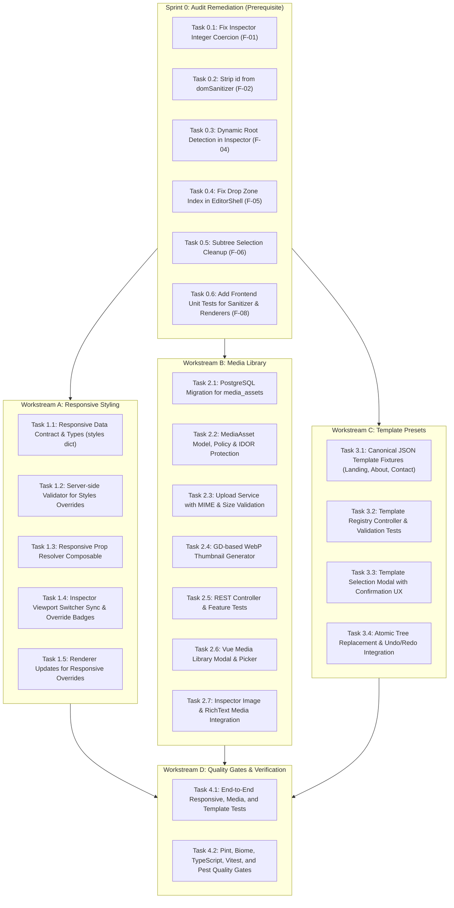

# Phase 06 — Business Analysis & Technical Implementation Plan
**Responsive Styling, Media Library, and Template Presets**  
**Document Version:** 1.0.0 | **Date:** 2026-10-17  
**Roles:** Principal Software Architect, Senior Laravel/Vue Engineer, Security Reviewer, Technical Business Analyst  
**Repository:** `D:\pentagon` | **Target Phase:** Phase 06 | **Prerequisite Phase:** Phase 05 (Audited)

---

## 1. Executive Summary & Phase Objectives

Phase 06 equips the Page Builder Admin with three pivotal capabilities while preserving low-resource server constraints (2GB RAM budget, no heavy services, no Redis/Octane/SSR):

1. **Responsive Styling (Workstream A):** Enables viewport-specific style overrides (Desktop, Tablet, Mobile) without bloating or breaking Document Schema v1, allowing seamless preview and publishing parity.
2. **Media Library (Workstream B):** Delivers a secure, multi-tenant asset repository with strict MIME content validation, safe non-executable storage, website-scoped isolation (IDOR protection), and lightweight thumbnail generation.
3. **Template Presets (Workstream C):** Provides canonical, schema-validated starter templates (Landing Page, About Page, Contact Page) with atomic replacement, undo/redo integration, and modal confirmation.
4. **Audit Remediation (Workstream 0):** Immediately resolves the 5 functional and security defects identified during the Phase 05 technical audit (integer prop coercion, DOM clobbering, hardcoded root checks, drop index handling, and selection cleanup).

---

## 2. Workstream 0: Phase 05 Defect Remediation (Prerequisite)

Before introducing new Phase 06 capabilities, the following defects discovered during the Phase 05 audit must be resolved to guarantee data integrity between client mutations and backend validation:

1. **F-01 (High): Type Coercion for Integer Enums in Inspector:**
   - *Target:* `resources/js/components/editor/InspectorPanel.vue`
   - *Fix:* When `<select>` emits a change for a property whose `schema.type === 'integer'`, parse the value with `parseInt(val, 10)` before dispatching `updateProp`. Ensures `Heading.level`, `Columns.count`, and `CardGrid.columns` remain integers.
2. **F-02 (High): Disallow `id` in Client DOM Sanitizer:**
   - *Target:* `resources/js/lib/domSanitizer.ts`
   - *Fix:* Remove `id` from the permitted attribute allowlist to eliminate DOM clobbering vectors against `document` and `window` in the active editor canvas.
3. **F-04 (Medium): Dynamic Root Node Identification:**
   - *Target:* `resources/js/components/editor/InspectorPanel.vue`
   - *Fix:* Replace `selectedNode.id !== 'root'` with `!isRoot` or `selectedNode.id !== document.root.id` to prevent Delete/Duplicate buttons from rendering on `root_section_default`.
4. **F-05 (Medium): Drop Zone Insertion Index Support:**
   - *Target:* `resources/js/components/editor/EditorShell.vue` and `useDocumentState.ts`
   - *Fix:* Extend `insertNode` to accept an explicit `targetIndex?: number` when inserting `inside` a container, and forward `payload.index` from `handleDropComponent`.
5. **F-06 (Low): Subtree Selection Cleanup on Delete:**
   - *Target:* `resources/js/composables/useDocumentState.ts`
   - *Fix:* In `deleteNode`, if `selectedNodeId` is a descendant of the deleted node (`isDescendant(selectedNodeId.value, nodeId)`), reset `selectedNodeId.value = null`.

---

## 3. Workstream A: Responsive Styling Architecture (Sprint 1 Gate A Specification)

### 3.1 Verified Source Findings & Schema v1 Compatibility Analysis
Before writing code, an exhaustive audit of all code paths that serialize, validate, clone, mutate, or render `DocumentNode` was conducted:

1. **`app/Domains/DocumentEngine/Validation/DocumentValidator.php`:**
   - In `validateNode()`, the validator does not reject extra keys on the `$node` array, but lines 342-348 return an explicit array containing only `['id', 'type', 'props', 'children']`.
   - *Impact:* Passing `styles` currently results in silent stripping upon sanitization.
   - *Mitigation:* Implement `validateStyles()` to validate and preserve `styles` in the sanitized return array when provided, while omitting it entirely when absent.
2. **`resources/js/composables/useDocumentState.ts`:**
   - In `cloneNodeWithNewIds()`, the cloning function constructs `{ id, type, props, children }`.
   - *Impact:* Duplicating a node would strip its `styles` dictionary.
   - *Mitigation:* Update `cloneNodeWithNewIds()` to deeply clone `styles: node.styles ? JSON.parse(JSON.stringify(node.styles)) : undefined`.
3. **`resources/js/composables/useEditorHistory.ts`:**
   - Uses `structuredClone(document.value)` for bounded undo/redo snapshots.
   - *Impact:* Perfectly preserves `styles` across undo and redo operations without loss.
4. **Existing Fixtures & Schema v1 Compatibility:**
   - Fixtures (`minimal_valid.json`, `all_twelve_components.json`) do not include `styles`.
   - Setting `styles` as an optional property (`styles?: { tablet?: Record<string, unknown>; mobile?: Record<string, unknown> }`) guarantees 100% backward compatibility for all existing documents. `schemaVersion` remains `1` without requiring schema migrations or version bumps.

---

### 3.2 Final Node Data Contract

```typescript
export interface ResponsiveStyleMap {
    tablet?: Record<string, unknown>;
    mobile?: Record<string, unknown>;
}

export interface DocumentNode<TProps = Record<string, unknown>> {
    id: string;
    type: CoreComponentType;
    props: TProps;
    styles?: ResponsiveStyleMap;
    children?: DocumentNode[];
}
```

- **Top-Level Viewport Keys:** Strictly `'tablet'` and `'mobile'`. Desktop is the canonical cascade root and its values reside directly in `node.props`. Any key other than `'tablet'` or `'mobile'` inside `styles` is rejected by the backend validator with `invalid_viewport_key`.
- **Empty Viewport Dictionaries:** Pruned automatically upon saving or resetting. If both viewports are empty, `styles` is omitted or set to `undefined`.

---

### 3.3 Authoritative 12-Component Responsive Property Allowlist

Every permitted property in `styles` is strictly presentational. All structural properties (content, text, URLs, children, IDs) are strictly forbidden in `styles`.

| Component Type | Permitted `styles` Properties | Data Type & Allowed Values | Presentation vs Structure | In Base `props`? |
| :--- | :--- | :--- | :--- | :--- |
| **`Section`** | `padding`<br>`background`<br>`display` | `string` (`none`, `small`, `medium`, `large`)<br>`string` (`transparent`, `muted`, `primary`, `dark`)<br>`string` (`visible`, `hidden`) | Presentation<br>Presentation<br>Presentation | Yes<br>Yes<br>Optional (default: `visible`) |
| **`Container`** | `maxWidth`<br>`centered`<br>`display` | `string` (`sm`, `md`, `lg`, `xl`, `full`)<br>`boolean`<br>`string` (`visible`, `hidden`) | Presentation<br>Presentation<br>Presentation | Yes<br>Yes<br>Optional (default: `visible`) |
| **`Heading`** | `align`<br>`display` | `string` (`left`, `center`, `right`)<br>`string` (`visible`, `hidden`) | Presentation<br>Presentation | Yes<br>Optional (default: `visible`) |
| **`RichText`** | `display` | `string` (`visible`, `hidden`) | Presentation | Optional (default: `visible`) |
| **`Image`** | `aspectRatio`<br>`display` | `string` (`auto`, `16:9`, `4:3`, `1:1`)<br>`string` (`visible`, `hidden`) | Presentation<br>Presentation | Yes<br>Optional (default: `visible`) |
| **`Button`** | `size`<br>`variant`<br>`display` | `string` (`sm`, `md`, `lg`)<br>`string` (`primary`, `secondary`, `outline`, `ghost`)<br>`string` (`visible`, `hidden`) | Presentation<br>Presentation<br>Presentation | Yes<br>Yes<br>Optional (default: `visible`) |
| **`Hero`** | `align`<br>`display` | `string` (`left`, `center`)<br>`string` (`visible`, `hidden`) | Presentation<br>Presentation | Yes<br>Optional (default: `visible`) |
| **`Columns`** | `count`<br>`gap`<br>`display` | `integer` (`2`, `3`, `4`)<br>`string` (`small`, `medium`, `large`)<br>`string` (`visible`, `hidden`) | Presentation<br>Presentation<br>Presentation | Yes<br>Yes<br>Optional (default: `visible`) |
| **`CardGrid`** | `columns`<br>`gap`<br>`display` | `integer` (`2`, `3`, `4`)<br>`string` (`small`, `medium`, `large`)<br>`string` (`visible`, `hidden`) | Presentation<br>Presentation<br>Presentation | Yes<br>Yes<br>Optional (default: `visible`) |
| **`FAQ`** | `display` | `string` (`visible`, `hidden`) | Presentation | Optional (default: `visible`) |
| **`Spacer`** | `size`<br>`display` | `string` (`small`, `medium`, `large`, `xlarge`)<br>`string` (`visible`, `hidden`) | Presentation<br>Presentation | Yes<br>Optional (default: `visible`) |
| **`Divider`** | `style`<br>`color`<br>`display` | `string` (`solid`, `dashed`, `dotted`)<br>`string` (`muted`, `primary`, `subtle`)<br>`string` (`visible`, `hidden`) | Presentation<br>Presentation<br>Presentation | Yes<br>Yes<br>Optional (default: `visible`) |

#### Strictly Forbidden Properties (Rejected with `disallowed_style_override`)
- Node identity & hierarchy: `id`, `type`, `children`.
- Content & text: `Heading.text`, `Heading.level` (semantic tag), `RichText.content`, `Button.label`, `Hero.title`, `Hero.subtitle`, `Hero.ctaText`, `FAQ.items`.
- URLs & media sources: `Image.src`, `Image.alt`, `Image.caption`, `Button.url`, `Button.target`, `Hero.ctaUrl`.

---

### 3.4 Viewport & CSS Breakpoint Semantics

#### 1. Viewport Width Ranges & Mapping
| Viewport Mode | Editor Preset Width | Media Query Range in Published CSS | Description |
| :--- | :--- | :--- | :--- |
| **`mobile`** | `375px` | `width < 768px` (Tailwind base utility) | Smartphones / small handhelds |
| **`tablet`** | `768px` | `768px <= width < 1024px` (Tailwind `md:`) | Tablets portrait / narrow laptops |
| **`desktop`** | `1280px` (base) | `width >= 1024px` (Tailwind `lg:`) | Desktops / large screens |

- **Non-Overlapping Boundary Guarantee:**
  - Mobile: $[0\text{px}, 767\text{px}]$
  - Tablet: $[768\text{px}, 1023\text{px}]$
  - Desktop: $[1024\text{px}, +\infty)$
- **Simulated Canvas vs. Physical Monitor:**
  - Because `EditorCanvas.vue` renders inside a sized container `div` rather than an isolated `iframe`, physical browser media queries evaluate to the user's host monitor (e.g. 1920px), NOT the canvas width.
  - Therefore, inside the editor canvas, renderers consume computed effective props via `resolveResponsiveProp(node, key, currentViewport)` based on the simulated viewport.

#### 2. Canonical Component Display Modes & Layout Behavior
Every component renderer has an intrinsic root display mode. Emitting generic `block` to restore visibility breaks grid, flex, and inline layouts. Therefore, an explicit canonical mapping is defined across all 12 core components:

| Component Type | Root Element in Renderer | Default CSS Display Mode ($D_C$) | Layout & Parent Context |
| :--- | :--- | :--- | :--- |
| **`Section`** | `<section>` | `block` | Full-width container |
| **`Container`** | `<div>` | `block` | Centered layout container |
| **`Heading`** | `<h1>`..`<h6>` | `block` | Semantic typography block |
| **`RichText`** | `<div class="prose">` | `block` | Prose content container |
| **`Image`** | `<figure>` | `block` | Visual asset container |
| **`Button`** | `<div class="inline-block">` | `inline-block` | Inline interactive trigger |
| **`Hero`** | `<div class="flex flex-col">` | `flex` | Vertical flex layout with centering |
| **`Columns`** | `<div class="grid">` | `grid` | Multi-column grid container |
| **`CardGrid`** | `<div class="grid">` | `grid` | Multi-card grid container |
| **`FAQ`** | `<div>` | `block` | Accordion list container |
| **`Spacer`** | `<div class="flex">` | `flex` | Dimensional spacer |
| **`Divider`** | `<div>` | `block` | Horizontal divider rule |

#### 3. Equivalent Published CSS Strategy & Breakpoint Restoration
When a component has responsive `display` overrides, the static compiler computes effective visibility at each breakpoint ($V_{\text{mobile}}, V_{\text{tablet}}, V_{\text{desktop}} \in \{\text{'visible'}, \text{'hidden'}\}$).

To restore the component's **original layout mode** without breaking its structure:
- If visible, its target display utility is its intrinsic mode $D_C \in \{\text{'block'}, \text{'inline-block'}, \text{'flex'}, \text{'grid'}\}$.
- If hidden, its utility is `'hidden'`.

The mobile-first compiler emits:
- If $V_M == \text{'hidden'}$ and $V_T == \text{'visible'}$: Emits `hidden md:${D_C}`.
- If $V_M == \text{'visible'}$, $V_T == \text{'hidden'}$, $V_D == \text{'visible'}$: Emits `${D_C} md:hidden lg:${D_C}`.
- If $V_M == \text{'hidden'}$, $V_T == \text{'hidden'}$, $V_D == \text{'visible'}$: Emits `hidden lg:${D_C}`.

#### 4. Tailwind CSS v4 Static Scanner Guarantee
Tailwind CSS v4 scans source files for literal class tokens. Constructing classes dynamically at runtime (e.g. `md:` + $D_C$) risks classes being omitted from the production CSS build (`public/build/assets/app-*.css`).
To guarantee that Tailwind's scanner includes every required breakpoint utility in the production build, an explicit static class lookup table is maintained in [`resources/js/lib/responsive.ts`](file:///D:/pentagon/resources/js/lib/responsive.ts):

```typescript
export const RESPONSIVE_DISPLAY_CLASSES = {
    block: {
        mobileHidden: 'hidden md:block',
        tabletHidden: 'block md:hidden lg:block',
        mobileAndTabletHidden: 'hidden lg:block',
    },
    'inline-block': {
        mobileHidden: 'hidden md:inline-block',
        tabletHidden: 'inline-block md:hidden lg:inline-block',
        mobileAndTabletHidden: 'hidden lg:inline-block',
    },
    flex: {
        mobileHidden: 'hidden md:flex',
        tabletHidden: 'flex md:hidden lg:flex',
        mobileAndTabletHidden: 'hidden lg:flex',
    },
    grid: {
        mobileHidden: 'hidden md:grid',
        tabletHidden: 'grid md:hidden lg:grid',
        mobileAndTabletHidden: 'hidden lg:grid',
    },
} as const;
```

#### 5. Concrete Responsive Display Examples by Component Type
1. **`Columns` (Intrinsic Mode: `grid`): Hidden on Mobile Only:**
   - $V_M = \text{'hidden'}, V_T = \text{'visible'}, V_D = \text{'visible'}$.
   - **Emits:** `hidden md:grid`.
   - *Result:* Mobile: hidden. Tablet & Desktop: restored strictly as `grid` (columns intact, not broken into block).
2. **`Button` (Intrinsic Mode: `inline-block`): Hidden on Mobile Only:**
   - $V_M = \text{'hidden'}, V_T = \text{'visible'}, V_D = \text{'visible'}$.
   - **Emits:** `hidden md:inline-block`.
   - *Result:* Mobile: hidden. Tablet & Desktop: restored as `inline-block` (not stretched to full-width block).
3. **`Hero` (Intrinsic Mode: `flex`): Hidden on Tablet Only:**
   - $V_M = \text{'visible'}, V_T = \text{'hidden'}, V_D = \text{'visible'}$.
   - **Emits:** `flex md:hidden lg:flex`.
   - *Result:* Mobile: `flex`. Tablet: hidden. Desktop: restored as `flex`.
4. **`Heading` (Intrinsic Mode: `block`): Hidden on Mobile & Tablet:**
   - $V_M = \text{'hidden'}, V_T = \text{'hidden'}, V_D = \text{'visible'}$.
   - **Emits:** `hidden lg:block`.
   - *Result:* Mobile & Tablet: hidden. Desktop: `block`.
5. **Child Node in `Columns` (Parent Grid Context):**
   - When a child node inside a column is hidden (`hidden md:block`), CSS `display: none` removes it from CSS grid auto-placement. On Tablet/Desktop, `md:block` re-inserts it into the grid layout seamlessly.

#### 6. Editor Canvas Behavior (`NodeRenderer.vue` - Gate B Work)
- In the active editor canvas, elements with `display: hidden` must **not** disappear completely; doing so would make them unselectable.
- When `resolveResponsiveProp(node, 'display', currentViewport) === 'hidden'`:
  - If **selected**: Render with `opacity-60 ring-2 ring-dashed ring-amber-500` and a badge `"Hidden on <Viewport>"`, enabling the user to configure or click "Reset to inherited".
  - If **unselected**: Render with `opacity-30 border border-dashed border-muted-foreground/40` so the hierarchy remains navigable.
- Removing an override removes the `display` key from `node.styles[viewport]` and immediately restores the inherited state without writing redundant `"visible"` values.

---

### 3.5 Inheritance Cascade, Columns/CardGrid Constraints & Reset Semantics

The property inheritance cascade is strictly top-down:
$$\text{Desktop (Base Props)} \longrightarrow \text{Tablet Overrides} \longrightarrow \text{Mobile Overrides}$$

```typescript
export function resolveResponsiveProp<T>(
    node: DocumentNode,
    propKey: string,
    currentViewport: ViewportMode
): T {
    const baseValue = (node.props as Record<string, unknown>)[propKey] as T;
    if (currentViewport === 'desktop' || !node.styles) {
        return baseValue;
    }

    if (currentViewport === 'tablet') {
        return (node.styles.tablet?.[propKey] as T) ?? baseValue;
    }

    if (currentViewport === 'mobile') {
        return (
            (node.styles.mobile?.[propKey] as T) ??
            (node.styles.tablet?.[propKey] as T) ??
            baseValue
        );
    }

    return baseValue;
}
```

#### Columns & CardGrid Constraint Resolution
- **Canonical Enum Retained:** Both base `props` and responsive `styles` strictly enforce `count/columns` $\in [2, 3, 4]$.
- **Why `1` is Not Permitted in the Data Contract:**
  1. `ColumnsRenderer.vue` and `CardGridRenderer.vue` already use responsive Tailwind classes (`grid-cols-1 md:grid-cols-2`) that automatically collapse multi-column layouts to 1 column on narrow mobile screens by default.
  2. Keeping `[2, 3, 4]` preserves the exact canonical schema from `ComponentRegistry` without diverging constraints between base props and responsive styles.
  3. Any value outside `[2, 3, 4]` (including `1`) is rejected by `DocumentValidator` with `invalid_enum_value`.

#### Concrete Inheritance & Reset Examples

1. **Example 1: Normal Inherited Property (No Overrides)**
   - Node: `Heading` with `props: { text: "Title", align: "left" }`, `styles: undefined`.
   - Desktop resolves to `'left'`.
   - Tablet resolves to `'left'` (inherited from Desktop).
   - Mobile resolves to `'left'` (inherited from Desktop).
   - In Inspector on Mobile: Displays `'left'` with indicator `Inherited from Desktop`.

2. **Example 2: Tablet Override Without Mobile Override**
   - Node: `Heading` with `props: { align: "left" }`, `styles: { tablet: { align: "center" } }`.
   - Desktop resolves to `'left'`.
   - Tablet resolves to `'center'` (explicit override).
   - Mobile resolves to `'center'` (inherited from Tablet).
   - In Inspector on Mobile: Displays `'center'` with indicator `Inherited from Tablet`.
   - Reset Action on Tablet: Deleting `styles.tablet.align` causes both Tablet and Mobile to immediately fall back to `'left'`.

3. **Example 3: Mobile Override Overriding Tablet and Desktop**
   - Node: `Columns` with `props: { count: 4 }`, `styles: { tablet: { count: 3 }, mobile: { count: 2 } }`.
   - Desktop resolves to `4`.
   - Tablet resolves to `3`.
   - Mobile resolves to `2`.
   - Reset Action on Mobile: Deleting `styles.mobile.count` causes Mobile to inherit `3` from Tablet.

4. **Example 4: `display: hidden` at One Breakpoint**
   - Node: `Image` with `props: { src: "hero.png" }`, `styles: { mobile: { display: "hidden" } }`.
   - Desktop: `display` is `'visible'`.
   - Tablet: `display` is `'visible'` (inherited).
   - Mobile: `display` is `'hidden'`.
   - Published CSS: Emits `hidden md:block`.

---

### 3.6 Backend Validation Requirements (`DocumentValidator::validateStyles`)

```php
private function validateStyles(
    mixed $rawStyles,
    string $normalizedType,
    ComponentDefinition $definition,
    string $nodePath,
    array &$errors
): ?array
```

#### Safe PHP JSON Decoding & Object/List Handling
When JSON is decoded with `json_decode($json, true)`:
- Both `styles: {}` and `styles: []` decode to an empty PHP array `[]`.
- In PHP 8.1+, `array_is_list([])` returns `true`, which would falsely reject valid empty `{}` if checked blindly.
- **Safe Validation Logic:**
  1. `!is_array($rawStyles)`: Emit `invalid_styles_format` at `{$nodePath}.styles` (`"Field 'styles' must be an associative object."`).
  2. `empty($rawStyles)`: Prune cleanly and return `null`. Omitted from sanitized node without error.
  3. `count($rawStyles) > 0 && array_is_list($rawStyles)`: Emit `invalid_styles_format` (`"Field 'styles' must be an associative object with viewport keys."`).
  4. For each viewport (`tablet`, `mobile`):
     - If viewport is not `'tablet'` or `'mobile'`: Emit `invalid_viewport_key`.
     - If viewport value is not an array or is a non-empty list: Emit `invalid_styles_format`.
     - If viewport value is empty `[]`: Prune that viewport.
     - For each override in `styles[$viewport]`:
       - If property is not in `RESPONSIVE_OVERRIDABLE_PROPS[$normalizedType]` and not `'display'`: Emit `disallowed_style_override`.
       - If property is `'display'`: Must be `'visible'` or `'hidden'`. If invalid, emit `invalid_enum_value`.
       - If property is known: Validate against `$definition->propSchemas[$key]` (type, enum, min/max). Emits `invalid_type` or `invalid_enum_value`.
  5. If after pruning, no viewport overrides remain: Return `null` and omit `styles` from the sanitized node.

---

### 3.7 Comprehensive Test Matrix

| Area | Test Case | Target Suite | Status |
| :--- | :--- | :--- | :--- |
| **Backend** | Minimal valid document without `styles` passes without regression | `DocumentValidatorTest.php` | Existing |
| **Backend** | Document with valid `styles` preserves `styles` after normalization | `DocumentValidatorTest.php` | To Add |
| **Backend** | Rejects non-associative `styles` (e.g. list array `[]` or primitive) with `invalid_styles_format` | `DocumentValidatorTest.php` | To Add |
| **Backend** | Rejects `desktop` viewport key in `styles` with `invalid_viewport_key` | `DocumentValidatorTest.php` | To Add |
| **Backend** | Rejects forbidden content override (e.g. `Heading.text`, `Image.src`) with `disallowed_style_override` | `DocumentValidatorTest.php` | To Add |
| **Backend** | Rejects invalid enum value in responsive style (e.g. `Heading.align: "diagonal"`) with `invalid_enum_value` | `DocumentValidatorTest.php` | To Add |
| **Backend** | Rejects integer type mismatch in `Columns.count` (e.g. string `"2"`) with `invalid_type` | `DocumentValidatorTest.php` | To Add |
| **Backend** | Rejects non-canonical `Columns.count = 1` or `CardGrid.columns = 1` with `invalid_enum_value` | `DocumentValidatorTest.php` | To Add |
| **Backend** | Validates universal `display: "visible" \| "hidden"` override across components | `DocumentValidatorTest.php` | To Add |
| **Backend** | Prunes empty `{}` or `[]` styles cleanly without throwing false `invalid_styles_format` | `DocumentValidatorTest.php` | To Add |
| **Frontend** | `resolveResponsiveProp()` correctly implements Desktop -> Tablet -> Mobile cascade | `tests/frontend/responsive.test.ts` | To Add |
| **Frontend** | Tests all 3 viewport ranges and boundary widths (375px, 768px, 1280px) | `tests/frontend/responsive.test.ts` | To Add |
| **Frontend** | Restores intrinsic display mode (`grid` for Columns/CardGrid, `flex` for Hero/Spacer, `inline-block` for Button, `block` for Heading/Section) | `tests/frontend/responsive.test.ts` | To Add |
| **Frontend** | Duplicating a node via `cloneNodeWithNewIds()` preserves `styles` | `tests/frontend/document-state.test.ts` | To Add |
| **Frontend** | Inspector updates `node.styles[viewport]` without mutating Desktop base `props` | `tests/frontend/inspector-helpers.test.ts` | To Add |
| **Frontend** | Resetting override deletes the viewport key and restores inherited value without persisting redundant `visible` | `tests/frontend/inspector-helpers.test.ts` | To Add |
| **Frontend** | Undo/redo atomically restores previous responsive style states | `tests/frontend/editor-history.test.ts` | To Add |
| **Frontend** | Viewer role displays responsive styles in read-only mode without allowing edits | `PageBuilderTest.php` | To Add |

---

### 3.8 Compatibility Risks & Status

- **Risk 1: Double-Editing Confusion in Inspector:** Users might inadvertently edit Desktop base values when intending to edit Mobile only.
  - *Mitigation:* Clear visual indicator in the Inspector header showing active viewport context (e.g., `"Editing for Mobile (375px)"` with color badge) and explicit "Reset to inherited" buttons on overridden fields.
- **Risk 2: Disappearing Hidden Elements:** Setting `display: hidden` on Mobile could cause elements to become unselectable on the canvas.
  - *Mitigation:* In editor canvas mode, `hidden` elements are rendered with reduced opacity (`opacity-60`) and a `"Hidden"` badge, ensuring they can always be selected and unhidden.

**Gate A Status:** `GATE A READY FOR APPROVAL`

---

## 4. Workstream B: Media Library Architecture

### 4.1 Business & UX Requirements
- An editor or admin can open the Media Library modal from:
  1. The Inspector panel when configuring an `Image` component.
  2. The RichText editor / FAQ repeater.
- Users can browse existing uploaded media for the current website with thumbnail previews, file size, and upload date.
- Users can upload new images via drag-and-drop or file picker.
- Selecting an asset inserts its safe public URL into the component prop.
- Users cannot access, view, or select assets belonging to another website (strict multi-tenant isolation).

### 4.2 Resource Constraints & Architecture Decisions
- **No Heavy Background Queues or Redis:** Upload processing will execute synchronously within strict limits.
- **RAM Budget Protection (2GB Server):**
  - Max upload size: **5 MB** per image.
  - Allowed image types: JPEG, PNG, WebP, GIF, SVG.
  - Dimension limits: Max 2560 x 2560 pixels.
  - Processing library: PHP GD extension (native to standard PHP runtime, avoiding heavyweight imagick memory spikes).
  - Thumbnail generation: Exactly one lightweight thumbnail (320px width, WebP format, quality 80) generated upon upload.

### 4.3 Database Schema (PostgreSQL Migration)

```sql
CREATE TABLE media_assets (
    id BIGSERIAL PRIMARY KEY,
    website_id BIGINT NOT NULL REFERENCES websites(id) ON DELETE CASCADE,
    storage_disk VARCHAR(32) NOT NULL DEFAULT 'public',
    storage_path VARCHAR(512) NOT NULL,
    thumbnail_path VARCHAR(512) NULL,
    original_filename VARCHAR(255) NOT NULL,
    mime_type VARCHAR(100) NOT NULL,
    size_bytes BIGINT NOT NULL,
    width INT NULL,
    height INT NULL,
    alt_text VARCHAR(255) NULL,
    uploaded_by BIGINT NOT NULL REFERENCES users(id) ON DELETE RESTRICT,
    created_at TIMESTAMP(0) WITHOUT TIME ZONE DEFAULT CURRENT_TIMESTAMP,
    updated_at TIMESTAMP(0) WITHOUT TIME ZONE DEFAULT CURRENT_TIMESTAMP,
    deleted_at TIMESTAMP(0) WITHOUT TIME ZONE NULL
);

CREATE INDEX media_assets_website_created_idx ON media_assets (website_id, created_at DESC);
CREATE INDEX media_assets_website_mime_idx ON media_assets (website_id, mime_type);
```

### 4.4 Security, Validation & IDOR Protection
1. **Server-Side MIME Sniffing:**
   - Must validate magic bytes via PHP `finfo_file(FILEINFO_MIME_TYPE)` or Laravel `File::mimeType()`, not client-supplied extensions.
   - SVG files: Must be passed through `symfony/html-sanitizer` or XML parser to strip embedded `<script>`, `onload`, and external entity injection (XXE).
2. **Safe Storage Paths:**
   - Disk: `public` disk (`storage/app/public/media/{website_id}/{year}/{month}/{random_hash}.{ext}`).
   - Files are stored with random UUID/SHA256 names, never original user filenames.
   - Nginx configuration ensures PHP scripts cannot be executed from `/storage/media/`.
3. **Multi-Tenant Authorization & IDOR Abort:**
   - Policy: `MediaAssetPolicy` checking `website->memberships()->where('user_id', $user->id)->exists()`.
   - Any access attempt to `websites/{website}/media/{media}` where `media.website_id !== website.id` immediately aborts with **HTTP 404** (per Architectural Decision D-008).
4. **Deletion Safety & Reference Rules:**
   - Soft deletes (`deleted_at`) ensure media deletion does not immediately break historical page revisions.
   - Deletion endpoint checks whether the asset is referenced in active drafts or published revisions, warning the user if references exist.

### 4.5 API Endpoints
- `GET /api/websites/{website}/media` — List paginated media with thumbnails and search.
- `POST /api/websites/{website}/media` — Upload media asset (multipart/form-data).
- `PUT /api/websites/{website}/media/{media}` — Update asset metadata (`alt_text`).
- `DELETE /api/websites/{website}/media/{media}` — Delete media asset.

---

## 5. Workstream C: Template Presets Architecture

### 5.1 Business & UX Requirements
- When working on an empty or existing page, the user can open a "Templates" modal.
- Three canonical templates are provided:
  1. **Landing Page:** Hero + Value Proposition Columns + Card Grid + FAQ + Call to Action Section.
  2. **About Page:** Page Header + Mission Section + 2-Column Story & Image + Team Card Grid.
  3. **Contact Page:** Header Section + Contact Details (RichText) + Location/Support FAQ + Button CTA.
- Applying a template on an existing canvas displays a destructive confirmation dialog:  
  *"Applying this template will replace current canvas content. This action can be undone with Ctrl+Z."*
- Applying a template is an **atomic mutation**:
  - The previous document is pushed as a single snapshot to `useEditorHistory`.
  - The document root is replaced with the template tree.
  - The editor selects the template's first section.
  - User can press `Ctrl+Z` to immediately restore their previous work.

### 5.2 Canonical Template Structure (Schema v1 Conforming)
Templates are pure JSON data files stored on the server under `resources/templates/v1/`:
- `landing_page.json`
- `about_page.json`
- `contact_page.json`

Every template must strictly validate against `DocumentValidator.php` during automated testing. No arbitrary executable JavaScript or client-side custom HTML is permitted.

### 5.3 Backend Template Registry API
- `GET /api/templates` — Returns available templates list: `id, name, description, category, thumbnail_url`.
- `GET /api/templates/{id}` — Returns the full validated `DocumentSchema` for the template.

---

## 6. Implementation Task Breakdown & Dependencies



---

## 7. Quality Gates & Acceptance Criteria Matrix

| Workstream | Acceptance Criteria | Objective Verification Method |
|---|---|---|
| **Remediation** | Changing `Heading.level` or `Columns.count` in Inspector saves valid integers, not strings. | `npm run test:frontend` + `php artisan test` validating against `DocumentValidator`. |
| **Remediation** | Client sanitizer rejects `<a id="body">` or namespaces it. | Vitest unit test in `domSanitizer.test.ts`. |
| **Remediation** | Dropping a component at top of container inserts at index 0. | Vitest unit test in `document-state.test.ts`. |
| **Workstream A** | Style overrides for tablet/mobile correctly inherit and override desktop props. | Unit tests for `resolveResponsiveProp`; visual check on mobile viewport preview. |
| **Workstream A** | Submitting structural props (`text`, `src`) in `styles` dictionary returns 422 validation error. | Pest test: `DocumentValidatorTest::test_rejects_structural_overrides_in_styles`. |
| **Workstream B** | Uploading non-image file renamed to `.jpg` is rejected by magic bytes inspection. | Pest test: `MediaUploadTest::test_rejects_fake_jpg_mime`. |
| **Workstream B** | Attempting to access or link media across websites returns HTTP 404. | Pest test: `MediaAuthorizationTest::test_cross_website_idor_returns_404`. |
| **Workstream B** | Uploading an image generates a WebP thumbnail under 50KB without exceeding RAM budget. | Pest test + file inspection in `storage/app/public/media/thumbnails/`. |
| **Workstream C** | Landing, About, and Contact templates successfully validate against `DocumentValidator.php`. | Pest test: `TemplateIntegrityTest::test_all_canonical_templates_pass_schema_v1`. |
| **Workstream C** | Applying a template over existing content can be completely reverted with a single `Ctrl+Z`. | Vitest frontend test in `editor-history.test.ts`. |
| **Global** | 0 lint errors, 0 type errors, 100% test pass rate, build under 5s. | `php vendor/bin/pint --test`, `npm run check`, `npm run types:check`, `npm run test:frontend`, `php artisan test`, `npm run build`. |

---

## 8. Architectural Decisions for Human Approval (Proposed)

### Proposed Decision D-018: Responsive Styling Contract via In-Node `styles` Dictionary
- **Context:** Viewport overrides (tablet, mobile) are required in Phase 06. Changing top-level schema to v2 would break Phase 03/04/05 fixtures and tests.
- **Proposal:** Maintain Schema v1 and introduce an optional `styles: { tablet?: Record<string, unknown>, mobile?: Record<string, unknown> }` on `DocumentNode`. Enforce in `DocumentValidator` that only presentational properties can be overridden.
- **Status:** **PROPOSED (Awaiting User Approval)**

### Proposed Decision D-019: Native PHP GD for Synchronous Image Thumbnails
- **Context:** Need thumbnail generation without introducing Redis, cloud workers, or high memory footprint.
- **Proposal:** Use native PHP GD functions to resize images to 320px WebP synchronously upon upload. Max upload size capped at 5MB, max dimensions 2560x2560.
- **Status:** **PROPOSED (Awaiting User Approval)**
